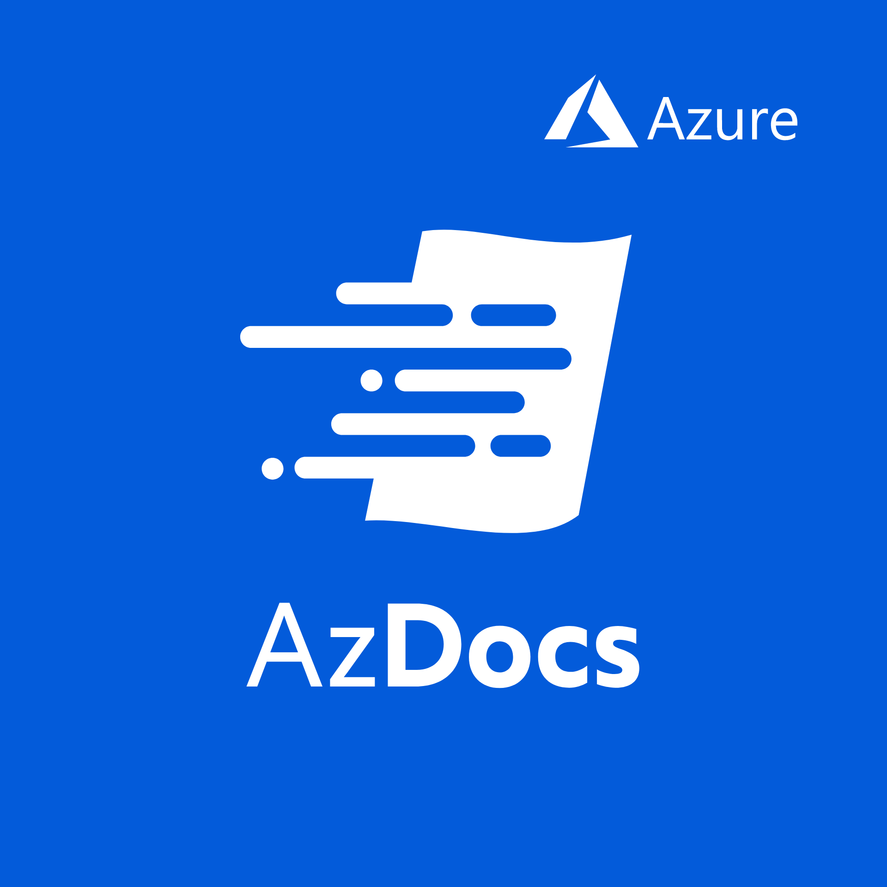

# AzDocs (Azure Documentation)

> [!IMPORTANT]
> **AzDocs is sunset as of 22 October 2026.** This repository is no longer maintained.
> For new and future work, please use [Azure Verified Modules (AVM)](https://aka.ms/avm).

## AzDocs is sunset

We started AzDocs in November 2020 with a set of Azure CLI scripts (v1), and added Bicep modules (v2) in July 2022. The goal was always the same: help teams build secure and compliant Azure platforms without having to work everything out themselves.

Since then, Microsoft has released [Azure Verified Modules](https://aka.ms/avm). AVM is the official, Microsoft-supported library of infrastructure-as-code modules for Bicep and Terraform. It covers the same ground as AzDocs, and it has a much larger team behind it. So we have decided to stop work on AzDocs and point you there instead.

### What this means for you

- We will not add new modules or features, fix bugs, or release security updates.
- We will not handle new issues or pull requests.
- The code stays available as it is. You can keep using it or fork it, but you do so at your own risk.

### Moving to Azure Verified Modules

- Start at the [AVM website](https://azure.github.io/Azure-Verified-Modules/) to learn how the modules work.
- Find a replacement for each AzDocs v2 module in the [Bicep resource module index](https://azure.github.io/Azure-Verified-Modules/indexes/bicep/bicep-resource-modules/). For example, `src-bicep/Cache/redis.bicep` maps to `br/public:avm/res/cache/redis`.
- Look at the [Bicep pattern modules](https://azure.github.io/Azure-Verified-Modules/indexes/bicep/bicep-pattern-modules/) for complete solutions that combine several resources.
- If you use Terraform, see the [Terraform resource module index](https://azure.github.io/Azure-Verified-Modules/indexes/terraform/tf-resource-modules/).
- AzDocs v1 (PowerShell and Azure CLI scripts) has no direct AVM equivalent. We advise you to move those deployments to AVM Bicep or Terraform modules.

Thank you to everyone who used AzDocs, reported issues, and contributed over the years. It was great to build this with you.

## About this repository

This is the AzDocs repository. This is meant to be imported into an Azure DevOps environment.

The idea behind this repository is that you are able to create compliant & secure resources within Azure without all the hassle of finding out how it all works and what you need.

- The documentation can be found in the `Wiki` directory. In Azure DevOps you can publish the `Wiki` folder as a Wiki (Publish Code as Wiki).
- The source code for the code snippits can be found in `src`.
- Unit tests for the snippits can be found in the tests directory. `NOTE: As of yet there are no unit tests yet.`
- tools can be found in the [`Tools`](Tools/) directory. For generating the bicep markdown documentation see [bicep](Tools/Bicep/).
